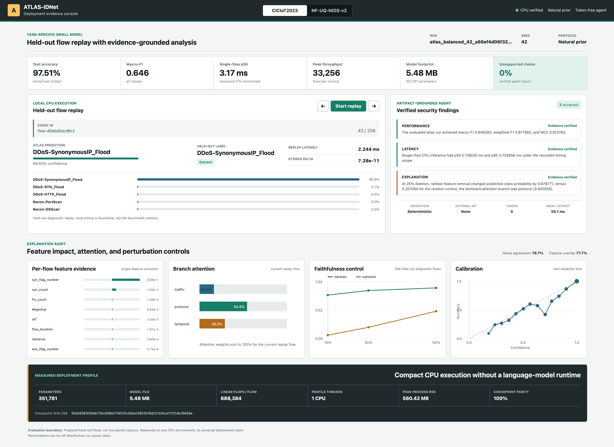

# ATLAS-IDNet Simulation

An interactive, browser-only replay of verified ATLAS-IDNet deployment evidence for CICIoT2023 and NF-UQ-NIDS-v2.

**Live simulation:** <https://deepakvermalab.github.io/ATLAS-IDNet-Simulation/>

The public console lets visitors move through de-identified held-out flows, inspect stored class probabilities, branch attention, single-feature occlusion evidence, calibration, faithfulness controls, measured resource characteristics, and deterministic artifact-grounded findings.

## Important scope

This is a **recorded evidence replay**, not a live network sensor and not browser-side model inference. The public repository contains no raw traffic, private checkpoint, personal identifier, API key, or language-model integration. Event identifiers are one-way hashes. Per-flow replay times were measured during export and are shown separately from the controlled CPU benchmark statistics.

## Run locally

```bash
python -m http.server 8000
```

Open <http://127.0.0.1:8000>.

## Contents

- `index.html`, `styles.css`, `app.js`: static simulation interface;
- `data/simulation.json`: de-identified recorded replay bundle;
- `assets/`: complete console captures used for repository documentation;
- `.nojekyll`: direct GitHub Pages static hosting.

## Research boundaries

- The replay uses prepared held-out diagnostic flows rather than live packet capture.
- Attention and occlusion are diagnostic evidence, not causal explanations.
- Results are protocol-specific and do not establish temporal or cross-site generalization.
- The reporting component is deterministic and token-free; it is not an LLM.
- Strong classical baselines outperform the neural detector in the matched predictive comparisons retained by the study.



